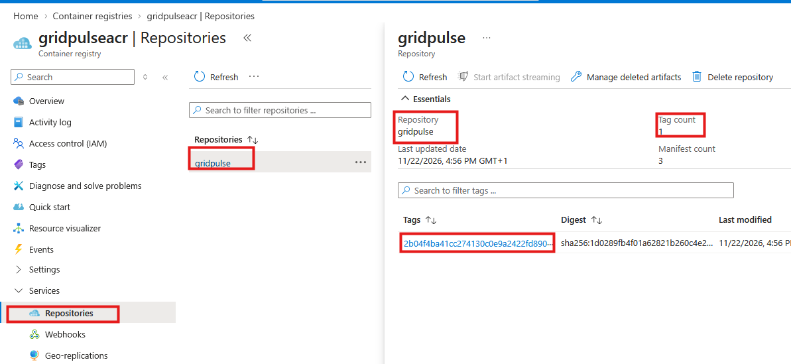
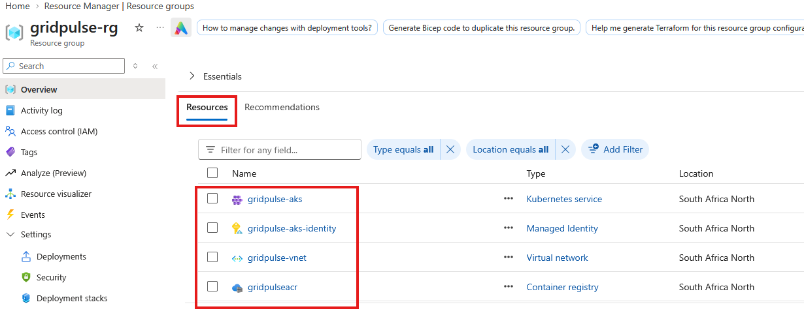
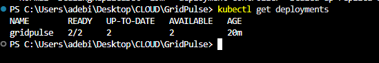

# GridPulse

**A containerized application deployed to Azure Kubernetes Service (AKS), with infrastructure provisioned using Terraform and CI/CD automation built with GitHub Actions.**

GridPulse is a lightweight application monitoring dashboard developed as part of the Group 3 Kubernetes Application Deployment capstone.

The project demonstrates the journey from local application development to Docker containerization, cloud infrastructure provisioning, Kubernetes orchestration, and automated deployment on Microsoft Azure.

## 1. The Problem

Running an application locally is only the first part of the deployment process. Moving it into a cloud environment introduces other responsibilities:

- How do we package the application so it runs consistently across environments?
- How do we provision the infrastructure required to host it?
- How do we deploy and manage application containers?
- How do we maintain application availability when a container fails?
- How do we automate testing and deployment without manually repeating every step?

GridPulse was developed to work through these challenges using Docker, Terraform, Azure Kubernetes Service, and GitHub Actions.

## 2. The Solution

GridPulse uses a Node.js and Express application with an HTML, CSS, and vanilla JavaScript frontend.

The application is packaged into a Docker image and stored in Azure Container Registry (ACR). Terraform provisions the Azure infrastructure, while Kubernetes manages the application deployment on AKS.

GitHub Actions handles the automation through two separate workflows:

- **Continuous Integration (`ci.yml`):** validates changes, runs automated tests, builds the Docker image, and verifies Azure authentication on successful pushes to `main`.
- **Continuous Deployment (`cd.yml`):** builds and publishes the application image to ACR, updates the Kubernetes Deployment, applies the manifests, and verifies the rollout.

The Kubernetes Deployment maintains two application replicas, while a LoadBalancer Service makes the application accessible externally.

## 3. Tools and Technology Choices

| Area | Technology | Purpose |
|---|---|---|
| Application | Node.js, Express.js | Backend application |
| Frontend | HTML, CSS, JavaScript | Dashboard interface |
| Testing | Node.js built-in test runner | Automated endpoint tests |
| Containerization | Docker | Package the application |
| Infrastructure as Code | Terraform | Provision Azure resources |
| Cloud platform | Microsoft Azure | Hosting environment |
| Container registry | Azure Container Registry | Store Docker images |
| Orchestration | Azure Kubernetes Service | Manage application containers |
| CI/CD | GitHub Actions | Automate validation and deployment |
| Authentication | Microsoft Entra ID, OIDC | Secure GitHub Actions authentication |
| Source control | Git and GitHub | Version control and collaboration |
| Development environment | Visual Studio Code, PowerShell | Development and command-line operations |

## 4. System Architecture and Design

The architecture separates application development, infrastructure provisioning, container storage, and application deployment.


### Deployment flow

1. Developers make application changes and test them locally.
2. GitHub stores the application source code and tracks changes.
3. The CI workflow runs when code is pushed to `main` or a pull request targets `main`.
4. After successful CI, the CD workflow authenticates to Azure using OpenID Connect.
5. The application is built into a Docker image and pushed to Azure Container Registry.
6. The CD workflow retrieves AKS credentials and updates the Kubernetes Deployment.
7. AKS runs the application Pods and maintains the configured replica count.
8. A Kubernetes LoadBalancer Service exposes the application to external users.

Terraform provisions the Azure infrastructure required by this deployment architecture.

## 5. Application Features

GridPulse includes:

- A dashboard served by the Express application.
- `GET /health` health endpoint.
- `GET /version` version endpoint.
- Runtime environment configuration through `NODE_ENV`.
- Application version configuration through `APP_VERSION`.
- JSON 404 and 500 error handling.
- Automated endpoint tests.

## 6. Implementation

### 6.1 Local application development and testing

The application was first installed, started, and tested locally before containerization.

**Requirements**

- Node.js 20 or newer (Node.js 24 was used during development).
- npm.

**Install dependencies**

```powershell
npm install
```

**Start the application**

```powershell
npm start
```

Open the application at:

```text
http://localhost:3000
```

**Run tests**

```powershell
npm test
```

The local testing stage helped verify the application before introducing Docker and Kubernetes.

### 6.2 Docker containerization

Docker was used to package GridPulse and its production dependencies into a container image.

The Dockerfile uses `node:24-alpine` as its base image, sets `/app` as the working directory, installs production dependencies with `npm ci --omit=dev`, copies the application files, and runs the application as the non-root `node` user.

The container listens on port `3000`.

Initial local image tags included:

```text
gridpulse:1.0.0
gridpulse:v1
```

The image was subsequently tagged for Azure Container Registry:

```text
gridpulseacr.azurecr.io/gridpulse:v1
```

The image was pushed to ACR, and the repository and image tags were verified.



### 6.3 Infrastructure provisioning with Terraform

Terraform was used to define and provision the Azure infrastructure required by GridPulse.

The infrastructure includes:

- Azure Resource Group: `gridpulse-rg`
- Azure Virtual Network and subnet.
- Network security configuration.
- Azure Container Registry: `gridpulseacr`
- Azure Kubernetes Service: `gridpulse-aks`
- AKS-to-ACR image pull permission.

**Azure region:** South Africa North.

The Terraform workflow involved initializing the working directory, validating the configuration, reviewing the execution plan, and applying the configuration.

The infrastructure was successfully provisioned and verified through Azure.



### 6.4 Kubernetes configuration

The Kubernetes manifests are maintained in the `k8s/` directory.

```text
k8s/
├── deployment.yaml
└── service.yaml
```

**Deployment**

The GridPulse Deployment is configured with:

- Two application replicas.
- A container image hosted in Azure Container Registry.
- Container port `3000`.
- Production environment configuration.
- Readiness and liveness probes using `/health`.
- CPU and memory requests and limits.

The Deployment controller maintains the desired number of Pods. If a Pod fails or is deleted, Kubernetes creates a replacement to restore the desired replica count.

**Service**

The Kubernetes Service uses the `LoadBalancer` type.

It exposes the application on port `80` and forwards traffic to port `3000` inside the application Pods.

This provides an external entry point to the application without requiring users to connect directly to individual Pods.

### 6.5 Deployment verification

The initial Kubernetes deployment was used to verify the application configuration and its behaviour on AKS. The subsequent CI/CD workflow automated image publishing and application deployment.

The following checks were performed:

- AKS node reached `Ready` status.
- Both GridPulse Pods reached `Running` status.
- Deployment reported `2/2` available replicas.
- LoadBalancer Service received an external IP address.
- The `/health` endpoint returned HTTP 200.
- Pod self-healing was tested by deleting a Pod and confirming that Kubernetes created a replacement.

Useful verification commands:

```powershell
kubectl get nodes
kubectl get deployments
kubectl get pods -o wide
kubectl get services
kubectl rollout status deployment/gridpulse
```

To test Pod self-healing:

```powershell
kubectl get pods
kubectl delete pod <pod-name>
kubectl get pods -w
```

The replacement Pod receives a new name. The Deployment controller works to maintain the configured two replicas.



### 6.6 CI/CD with GitHub Actions

The automation is separated into two workflow files under `.github/workflows/`.

```text
.github/
└── workflows/
    ├── ci.yml
    └── cd.yml
```

#### Continuous Integration — `ci.yml`

The CI workflow runs when code is pushed to `main` or a pull request targets `main`.

Its steps include:

1. Check out the repository.
2. Set up Node.js.
3. Install dependencies using `npm ci`.
4. Run automated tests using `npm test`.
5. Build the Docker image.
6. Verify Azure OIDC authentication on successful pushes to `main`.

This workflow provides an automated validation stage before deployment.

The CI workflow was executed successfully, including the automated tests, Docker build, and Azure authentication check.

#### Continuous Deployment — `cd.yml`

The separate CD workflow handles deployment after a successful CI run on a push to `main`.

Its deployment process:

1. Authenticates to Azure using OpenID Connect (OIDC).
2. Builds a Docker image tagged with the Git commit SHA.
3. Pushes the image to Azure Container Registry.
4. Retrieves AKS credentials.
5. Updates the Kubernetes Deployment with the new image.
6. Applies the Kubernetes Deployment and Service manifests.
7. Waits for the deployment rollout and checks the resulting resources.

Using the Git commit SHA as the image tag makes it possible to identify the source revision associated with a deployed image.

**Authentication and access**

GitHub Actions authenticates to Azure through Microsoft Entra federated credentials and OIDC. This avoids depending on a long-lived Azure client secret for workflow authentication.

The GitHub Actions identity also requires the appropriate permissions to push images to ACR and access the AKS cluster.


## 7. Challenges and Solutions

| Challenge | Solution |
|---|---|
| Ensuring AKS could pull images from ACR | Configured the AKS kubelet identity with the `AcrPull` role on the registry. |
| Authenticating GitHub Actions to Azure | Configured Microsoft Entra federated credentials and GitHub repository secrets for OIDC authentication. |
| Granting GitHub Actions access to Azure resources | Assigned the required ACR push and AKS credential access roles to the GitHub Actions identity. |
| Managing container image versions | Used Git commit SHA tags in the automated deployment workflow so each deployment can reference a specific source revision. |
| Verifying application availability | Used Kubernetes readiness and liveness probes and tested the `/health` endpoint. |
| Maintaining application availability after Pod failure | Tested Kubernetes self-healing by deleting a Pod and observing its replacement. |
| Managing infrastructure and application deployment separately | Used Terraform for infrastructure provisioning and Kubernetes manifests for application configuration. |

## 8. Project Structure

```text
GridPulse/
│
├── .github/
│   └── workflows/
│       ├── ci.yml
│       └── cd.yml
│
├── k8s/
│   ├── deployment.yaml
│   └── service.yaml
│
├── terraform/
│   ├── main.tf
│   ├── variables.tf
│   └── outputs.tf
│
├── screenshots/
│
├── Dockerfile
├── package.json
├── package-lock.json
├── server.js
└── README.md
```

## 9. Lessons Learned

Working on GridPulse provided practical experience with:

- Building and testing a Node.js application.
- Packaging applications using Docker.
- Provisioning cloud infrastructure with Terraform.
- Deploying containerized applications to AKS.
- Configuring Kubernetes Deployments, Services, and health probes.
- Managing container images with Azure Container Registry.
- Configuring separate CI and CD workflows with GitHub Actions.
- Using OIDC for GitHub Actions authentication to Azure.
- Troubleshooting cloud permissions, deployment configuration, and application availability.
- Collaborating through Git branches and Pull Requests.

One important distinction from this project is that provisioning infrastructure and deploying an application are separate responsibilities. Terraform created the Azure environment; Kubernetes defined how the application should run; and GitHub Actions connected the source-code changes to the deployment process.

## 10. Further Documentation

The following articles provide more detailed implementation notes and walkthroughs for each project stage.

| Stage | Documentation |
|---|---|
| 1. Local application development | [Before Docker and Kubernetes: Running a Node.js Application Locally](https://medium.com/@akpeziorieruo/before-docker-and-kubernetes-running-a-node-js-application-locally-cf724bcd161e) |
| 2. Docker containerization | [Taking GridPulse Beyond Local Deployment: My Next Step with Docker](https://medium.com/@akpeziorieruo/taking-gridpulse-beyond-local-deployment-my-next-step-with-docker-5228c644b27f) |
| 3. Terraform infrastructure | *Add the correct Terraform article link here.* |
| 4. Kubernetes configuration | [Preparing GridPulse for Kubernetes: Creating Deployment and Service Manifests](https://medium.com/@akpeziorieruo/preparing-gridpulse-for-kubernetes-creating-deployment-and-service-manifests-b94099a3cf04) |
| 5. CI/CD implementation | [Automating GridPulse Deployment to AKS with GitHub Actions and OpenID Connect](https://medium.com/@akpeziorieruo/automating-gridpulse-deployment-to-aks-with-github-actions-and-openid-connect-6531fd222bfa) |
| 6. Final deployment and testing | [End-to-End Deployment and Verification](https://medium.com/@akpeziorieruo/final-deployment-and-testing-of-gridpulse-on-azure-kubernetes-service-d7524e55f668) |

---

**Repository:** [GridPulse on GitHub](https://github.com/ufuomaorieruo/GridPulse)  
**Cloud Platform:** Microsoft Azure  
**Region:** South Africa North