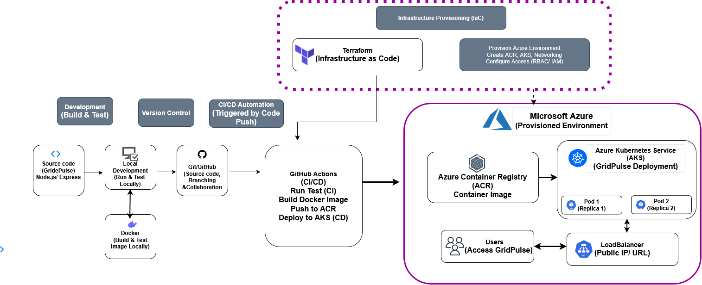
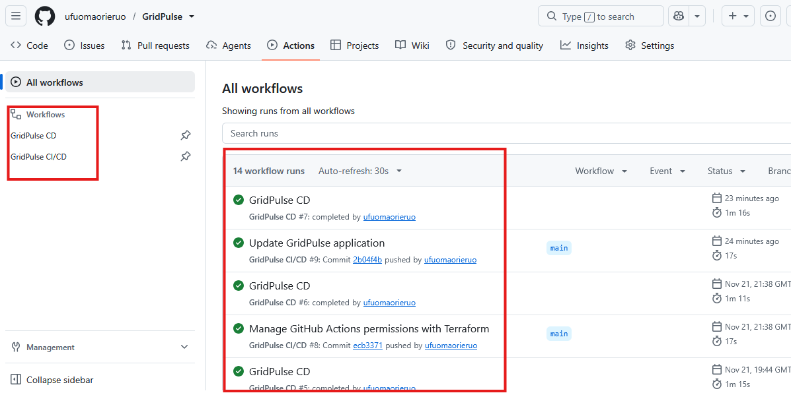

# GridPulse

**A containerized application deployed to Azure Kubernetes Service (AKS), with infrastructure provisioned using Terraform and deployment automation built with GitHub Actions.**

GridPulse is a lightweight application monitoring dashboard developed as part of the Group 3 Kubernetes Application Deployment capstone.

The project demonstrates the journey from local application development to containerization, cloud infrastructure provisioning, Kubernetes orchestration, and CI/CD automation on Microsoft Azure.

## Project Overview

GridPulse is a Node.js and Express application with an HTML, CSS and vanilla JavaScript frontend. It exposes health and version endpoints and is designed to run inside Docker containers managed by Kubernetes.

The project brings together infrastructure as code, containerization, cloud-native deployment, and automated delivery.

## Architecture

The solution uses Microsoft Azure for its cloud infrastructure and GitHub for source control and automation.



### Deployment flow

1. Developers build and test the application locally.
2. Docker packages the application into a container image.
3. Terraform provisions the Azure infrastructure.
4. The container image is pushed to Azure Container Registry (ACR).
5. Kubernetes manifests define the application Deployment and Service on AKS.
6. GitHub Actions automates CI checks and the deployment process.
7. Users access the application through the Kubernetes LoadBalancer Service.


## Technology Stack

| Area | Technologies |
|---|---|
| Application | Node.js, Express.js |
| Frontend | HTML, CSS, JavaScript |
| Testing | Node.js built-in test runner |
| Containerization | Docker |
| Infrastructure as Code | Terraform |
| Cloud platform | Microsoft Azure |
| Container registry | Azure Container Registry (ACR) |
| Orchestration | Azure Kubernetes Service (AKS), Kubernetes |
| CI/CD | GitHub Actions |
| Authentication | Microsoft Entra ID, OpenID Connect (OIDC) |
| Source control | Git and GitHub |
| Development environment | Visual Studio Code, PowerShell |

## Application Features

- Dashboard served by the Express application.
- `GET /health` health endpoint.
- `GET /version` version endpoint.
- Runtime environment configuration through `NODE_ENV`.
- Application version configuration through `APP_VERSION`.
- JSON 404 and 500 error handling.
- Automated endpoint tests.

## Running the Application Locally

### Requirements

- Node.js 20 or newer (Node.js 24 was used during development).
- npm.

### Installation

```powershell
npm install
npm start
```

Open the application at:

```text
http://localhost:3000
```

### Development mode

```powershell
npm run dev
```

### Run tests

```powershell
npm test
```

## Docker Containerization

The application was containerized using a Dockerfile at the project root.

The Docker image was built and tested locally before being tagged and pushed to Azure Container Registry.

The initial local image tags included:

```text
gridpulse:1.0.0
gridpulse:v1
```

The image was subsequently tagged for ACR:

```text
gridpulseacr.azurecr.io/gridpulse:v1
```

The image was pushed to ACR and its repository and tag were verified.


## Infrastructure Provisioning with Terraform

Terraform was used to define and provision the Azure infrastructure required by GridPulse.

The infrastructure includes:

- Azure Resource Group: `gridpulse-rg`
- Azure Virtual Network and subnet.
- Network security configuration.
- Azure Container Registry: `gridpulseacr`
- Azure Kubernetes Service: `gridpulse-aks`
- AKS-to-ACR image pull permission.

**Azure region:** South Africa North

Terraform was used to initialize the working directory, validate the configuration, review the execution plan, and provision the resources.

The infrastructure was successfully provisioned and verified through Azure Portal.


## Kubernetes Configuration

Kubernetes manifests are maintained in the `k8s/` directory.

```text
k8s/
├── deployment.yaml
└── service.yaml
```

### Deployment

The GridPulse Deployment is configured with:

- Two application replicas.
- Container image hosted in Azure Container Registry.
- Container port `3000`.
- Production environment configuration.
- Readiness and liveness probes using `/health`.
- CPU and memory requests and limits.

### Service

The Kubernetes Service uses the `LoadBalancer` type.

It exposes the application on port `80` and forwards traffic to port `3000` inside the application Pods.

### Deployment verification

The application was manually deployed to AKS and verified.

- AKS node reached `Ready` status.
- Both GridPulse Pods reached `Running` status.
- Deployment reported `2/2` available replicas.
- LoadBalancer Service received an external IP address.
- The `/health` endpoint returned HTTP 200.
- Pod self-healing was tested by deleting a Pod and confirming that Kubernetes created a replacement.


## CI/CD with GitHub Actions

GitHub Actions is used to automate the validation and deployment workflow.

The implementation separates Continuous Integration and Continuous Deployment into two workflow files.

### Continuous Integration

The CI workflow runs when code is pushed to `main` or a Pull Request targets `main`.

Its steps include:

1. Check out the repository.
2. Set up Node.js.
3. Install dependencies using `npm ci`.
4. Run automated tests using `npm test`.
5. Build the Docker image.
6. Verify Azure OIDC authentication on successful pushes to `main`.

The CI workflow was executed successfully, including the automated tests, Docker build, and Azure authentication check.

### Continuous Deployment

The separate CD workflow is designed to run after a successful CI workflow on a push to `main`.

Its deployment process:

1. Authenticates to Azure using OIDC.
2. Builds a Docker image tagged with the Git commit SHA.
3. Pushes the image to Azure Container Registry.
4. Retrieves AKS credentials.
5. Updates the Kubernetes Deployment with the new image.
6. Applies the Kubernetes Deployment and Service manifests.
7. Waits for the deployment rollout and checks the resulting resources.

This approach avoids relying on long-lived Azure credentials stored in GitHub.



*The final end-to-end CD run will be added here after pipeline verification.*

## Challenges and Solutions

| Challenge | Solution |
|---|---|
| Kubernetes Deployment manifest indentation errors | Reviewed and corrected YAML structure before applying the manifests. |
| Ensuring AKS could pull images from ACR | Configured the AKS kubelet identity with the `AcrPull` role on the registry. |
| Authenticating GitHub Actions to Azure | Configured Microsoft Entra federated credentials and GitHub repository secrets for OIDC authentication. |
| Granting GitHub Actions access to Azure resources | Assigned the required ACR push and AKS credential access roles to the GitHub Actions identity. |
| Managing container image versions | Used Git commit SHA tags in the automated deployment workflow so each deployment can reference a specific source revision. |
| Verifying application availability | Used Kubernetes readiness and liveness probes and tested the `/health` endpoint. |
| Maintaining application availability after Pod failure | Tested Kubernetes self-healing by deleting a Pod and observing its replacement. |

## Project Structure

```text
GridPulse/
│
├── .github/
│   └── workflows/
│       ├── ci.yml
│       └── cd.yml
│
├── k8s/
│   ├── deployment.yaml
│   └── service.yaml
│
├── terraform/
│   ├── main.tf
│   ├── variables.tf
│   └── outputs.tf
│
├── screenshots/
│
├── Dockerfile
├── package.json
├── package-lock.json
├── server.js
└── README.md
```

## Lessons Learned

Working on GridPulse provided practical experience with:

- Building and testing a Node.js application.
- Packaging applications using Docker.
- Provisioning cloud infrastructure with Terraform.
- Deploying containerized applications to AKS.
- Configuring Kubernetes Deployments, Services and health probes.
- Managing container images with Azure Container Registry.
- Configuring GitHub Actions and OIDC authentication.
- Troubleshooting cloud permissions, deployment configuration and application availability.
- Collaborating through Git branches and Pull Requests.

## Further Documentation

The following documents provide more detailed implementation notes and walkthroughs for each project stage.

| Stage | Documentation |
|---|---|
| 1. Local application deployment | [Local Development and Testing](https://medium.com/@akpeziorieruo/before-docker-and-kubernetes-running-a-node-js-application-locally-cf724bcd161e) |
| 2. Docker containerization | [Docker Containerization](https://medium.com/@akpeziorieruo/taking-gridpulse-beyond-local-deployment-my-next-step-with-docker-5228c644b27f) |
| 3. Terraform infrastructure | [Azure Infrastructure with Terraform](https://medium.com/@akpeziorieruo/taking-gridpulse-beyond-local-deployment-my-next-step-with-docker-5228c644b27f) |
| 4. Kubernetes configuration and deployment | [Kubernetes Deployment on AKS](https://medium.com/@akpeziorieruo/preparing-gridpulse-for-kubernetes-creating-deployment-and-service-manifests-b94099a3cf04) |
| 5. Continuous Integration and Deployment | [GitHub Actions CI/CD Implementation](https://medium.com/@akpeziorieruo/automating-gridpulse-deployment-to-aks-with-github-actions-and-openid-connect-6531fd222bfa) |
| 6. Final deployment and testing | [End-to-End Deployment and Verification](docs/06-final-deployment-testing.md) |

---
 
**Repository:** [GridPulse on GitHub](https://github.com/ufuomaorieruo/GridPulse)  
**Cloud Platform:** Microsoft Azure